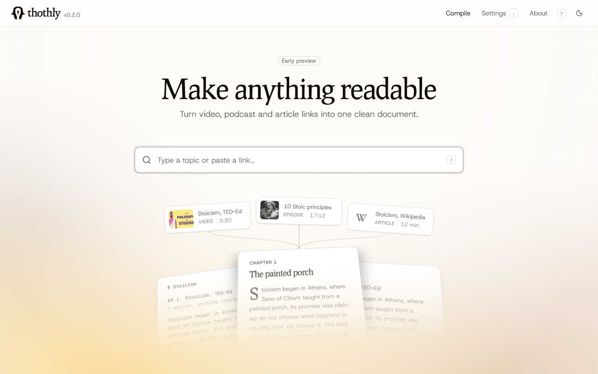

<p align="center">
  <picture>
    <source media="(prefers-color-scheme: dark)" srcset="docs/assets/thothly_logotype_white.svg">
    
  </picture>
</p>

<p align="center"><em>Make anything readable. Turn video, podcast and article links into one clean document.</em></p>

<p align="center"><a href="https://thothly.vercel.app"><strong>Try the demo</strong></a></p>

<p align="center">
  <a href="https://github.com/wl2bd/thothly/actions/workflows/ci.yml"></a>
</p>

<p align="center">
  
</p>

Thothly is a self-hostable, open-source tool that turns content from across the
web (YouTube videos, playlists and channels, blogs, and podcasts) into one
polished **compilation** you can actually read: a clean EPUB for your e-reader,
plus a plain-Markdown twin you can hand straight to an AI.

Thothly is about **reading**, not querying. It is the complement of tools like
NotebookLM (which do RAG / Q&A over sources): Thothly curates, formats, and ships
a book, with typography, a table of contents, chapter breaks, and source
attribution, so the result feels like an Instapaper edition rather than a text
dump.

## ▸ Features

- **Search or paste.** Type a query to search YouTube, podcasts, and the web at
  once (all keyless), or paste a link directly: single videos, playlists,
  channels, blog homepages, Wikipedia articles, or RSS feeds. The source type is
  auto-detected, with no dropdowns. Filter results by type (video, episode,
  article) and sort by relevance, duration, or title. Titles show in the source's
  own language, never an auto-translation. Job boards, shops and social posts are
  never offered as articles, and an optional triage model drops results that
  can't be compiled or are off topic.
- **Build it in one workspace.** Search and your sources on the left, the
  compilation on the right, from the first link to the finished book. Up to five
  sources per compilation, each one named and removable (with undo).
- **Review before you compile.** Discovery tags every item with what was actually
  retrieved (a clean transcript, raw captions, web text, or nothing usable), plus
  a no-LLM preview of exactly what each item would contribute. Each row says up
  front what will happen to it (left out, raw captions, transcribed) and how to
  fix it. You tick what makes the book; anything metered (transcription, AI
  polish on your key) shows its estimated cost, down to the Compile button.
- **Stop when you want.** A long compile can be stopped at any time: it ends
  before the next AI call and keeps the chapters already built.
- **Two formats, one compilation.** Every job produces a clean EPUB (sources
  index, per-chapter attribution, YouTube chapters as sub-headings, an editorial
  cover, Instapaper-grade typography) and a standalone Markdown twin of the same
  content. Read the EPUB on an e-reader, or copy the Markdown straight into an AI.
- **Read it, send it, or hand it to an AI.** The finished book opens in a reader
  with its contents beside it. Download the EPUB in one click, get the Markdown,
  copy the Markdown to paste into a chat, or send the book to an e-reader (the
  device's share sheet, Send to Kindle, or instructions for Kobo and others).
- **Zero-LLM by default.** Native subtitles and article text, never rewritten,
  and kept in the source's original language (titles, chapters, and body),
  never auto-translated.
- **Optional AI polish.** Re-punctuate raw captions, copyedit, infer section
  headings, or generate a preface. Entirely opt-in, with the server's model or
  your own key (see below).
- **Your compilations, in your browser.** Past books are listed by status (To
  review, Ready) and reopen in one click. History and keys are stored only in
  the browser; deleting a book can be undone for a few seconds.
- **Keyboard first.** `/` to search, `Mod+Enter` for the next step, `A` to select
  every item, `D` to download, `C` to copy, arrows to turn chapters, `,` for
  Settings. Press `?` for the full list.
- **Examples to start from.** Two ready-made compilations on the home page (a
  book about Stoicism, and the Markdown an AI gets for "How transformers work"),
  both downloadable.
- **Podcasts as text.** A transcript the show publishes in its own feed is used
  first, for free. Otherwise episodes are transcribed by any OpenAI-compatible
  speech-to-text endpoint or ElevenLabs, with diarized speaker labels.
- **Self-hosted, single-user.** No accounts, runs on your machine. No analytics
  are sent unless you set a PostHog key yourself.

## ▸ How it works

```
search / paste links → discovery → review → compile → download (EPUB + Markdown)
```

You stage one or more sources, from search results or pasted URLs, and start a
job (`POST /jobs`). Discovery enumerates the items (cheap, in the background) and
the job moves to `reviewing`. You pick the items, an optional title, and any LLM
cleanup roles (`POST /jobs/{id}/confirm`); compilation fetches the selected
content, renders a single EPUB with Pandoc plus its Markdown twin, and the job
reaches `completed` (`POST /jobs/{id}/stop` ends it early with the chapters
built so far). Then you download it (`GET /jobs/{id}/download`, or
`?format=md` for the Markdown). Job state lives in SQLite, with no Redis and no
Celery.

## ▸ Prerequisites

- Docker Engine 24+
- Docker Compose v2 (bundled with recent Docker Desktop)

That is all. Everything else (Node, Python, `uv`, `pnpm`, Pandoc) runs inside the
containers.

## ▸ Quickstart

```bash
cp .env.example .env
docker compose up --build
```

Open <http://localhost:3000>, search for something (or paste a YouTube/blog
link), and follow discovery → review → compile. The backend API is published on
`:8000` (interactive docs at <http://localhost:8000/docs>) for direct
exploration. Generated files and the SQLite database persist in `./data`.

## ▸ Optional AI polish

By default Thothly is **zero-LLM**: punctuated captions are split into clean
paragraphs for free, and raw (unpunctuated) captions fall back to a simple
grouping. You can optionally enable an LLM layer that, at compile time and only
on the items you selected, runs the roles you tick in the review screen:

- **Punctuation.** Restores punctuation and paragraphs to raw transcripts.
- **Copyedit.** Removes filler words and obvious speech-recognition mistakes.
- **Sections.** Infers section headings for content without chapters.
- **Preface.** Generates a short opening preface for the book.

One OpenAI-compatible endpoint covers every provider: point `LLM_BASE_URL`,
`LLM_MODEL` (and `LLM_API_KEY` when required) at Ollama (local, free), Mistral,
OpenAI, OpenRouter, etc. See `.env.example`. Each pass is **verified**: the output
is compared to the source and any drift (paraphrase, truncation, hallucination)
is rejected in favour of the original text, so the LLM can never silently rewrite
your book. Results are cached per (content, role-set, model), so re-compiling is
free, and any failure falls back to the zero-LLM path, so it never breaks a
compile. Leave the variables empty to keep Thothly fully free.

Visitors can also bring their own model: **Settings** (the `,` key) takes one key
per provider and a provider and model per task (cleanup, podcast transcription).
Keys are checked when pasted, kept only in the browser, and sent with a job only
to run it. By default only the listed providers are allowed; set
`BYOK_ALLOW_CUSTOM_BASE_URL=true` to accept any server address on an instance
whose users you trust.

## ▸ Optional podcast transcription

Search also covers **podcasts** (Apple's keyless iTunes index). When a show
publishes a transcript in its RSS feed, Thothly reads that and nothing is
transcribed; with `TREG_TOKEN` or `MONID_API_KEY` set, it also looks up a
published transcript at discovery. Otherwise a picked episode is audio, so
turning it into a chapter needs a speech-to-text endpoint. Point `STT_BASE_URL`, `STT_MODEL`
(and `STT_API_KEY` when required) at any OpenAI-compatible `audio/transcriptions`
endpoint: **Mistral Voxtral** (`voxtral-mini-latest`), a local vLLM/whisper.cpp
server (no key), or OpenAI. Visitors can also use their own ElevenLabs key from
Settings. See `.env.example`.

Transcription runs lazily, only for the episodes you select, and is cached by
audio URL, so re-compiling never re-pays for it. Episodes keep their diarized
dialogue with per-speaker labels; when an LLM is configured, real speaker names
are resolved by default (`PODCAST_SPEAKER_NAMING`), so disable it for plain
"Speaker N" labels. Long episodes are split into chunks (default 55 min), which
needs `ffmpeg` installed (short ones transcribe without it). Leave the variables
empty and episodes are simply skipped; many podcasts are also on YouTube, where
native subtitles already cover them for free.

## ▸ Configuration

All settings have sensible defaults; see `.env.example` for the full list.

| Variable | Default | Purpose |
| --- | --- | --- |
| `DATA_DIR` | `/data` | SQLite DB + generated files (mounted from `./data` in Compose) |
| `BACKEND_URL` | `http://backend:8000` | Frontend to backend (set by Compose; override only outside it) |
| `MARGINALIA_API_KEY` | `public` | Marginalia key, used only when no gateway key is set; `public` works keyless, personal/commercial keys lift the rate limit / licence |
| `TREG_TOKEN` / `MONID_API_KEY` | empty | Pay-per-call data gateways (treg first, Monid as fallback): YouTube transcripts (and search, when triage is on) through ScrapeCreators (yt-dlp is IP-blocked from data centers), web search (TinyFish, then Exa), and published podcast transcripts looked up before any speech-to-text. Answers are cached, so the same call is paid once |
| `LLM_BASE_URL` / `LLM_MODEL` / `LLM_API_KEY` | empty | Optional LLM endpoint (see above). On OpenRouter, the same key also turns on search triage: a decision model drops results that can't be compiled or are off topic, then re-ranks |
| `STT_BASE_URL` / `STT_MODEL` / `STT_API_KEY` | empty | Optional speech-to-text endpoint for podcast episodes (see above) |
| `BYOK_ALLOW_CUSTOM_BASE_URL` | `false` | Let users enter any server address for their own model, not just the listed providers. Only for an instance whose users you trust: the server calls whatever they type |
| `PODCAST_SPEAKER_NAMING` | `true` | Resolve real speaker names via the LLM (otherwise plain "Speaker N") |
| `POSTHOG_PROJECT_TOKEN` / `POSTHOG_HOST` | empty | Optional product analytics (jobs created, compiles finished or failed, downloads, paid calls), sent without person profiles. Unset sends nothing |

### Web search

YouTube and podcasts have one backend each. Web/article search picks its engine
from the keys you set; there is nothing to configure:

| Keys | Engine | Commercial use | Notes |
| --- | --- | --- | --- |
| `TREG_TOKEN` or `MONID_API_KEY` | TinyFish, then Exa | yes (TinyFish free; Exa metered, ~$0.007 a search, only when TinyFish fails) | TinyFish answers every query for free, which matters because the search runs as you type. Exa searches by meaning and takes over when TinyFish can't answer. |
| none | Marginalia | free key is **non-commercial** (CC-BY-NC-SA); paid commercial key available | Keyless. Independent "small web": blogs, docs, long-form. `public` key shares a tight limit; email `contact@marginalia-search.com` for a free personal key. |

## ▸ Running without Docker

The Docker setup is the contract. For day-to-day iteration you can also run each
service directly:

```bash
# Backend
cd backend
uv sync
uv run uvicorn app.main:app --reload

# Frontend (in another terminal)
cd frontend
pnpm install
BACKEND_URL=http://127.0.0.1:8000 pnpm dev
```

The Markdown companion is free, but the EPUB step shells out to **Pandoc**, so
install it locally if you compile outside Docker.

The checks CI runs:

```bash
# Backend
uv run ruff check . && uv run pytest -q

# Frontend
pnpm lint && pnpm test && pnpm typecheck && pnpm build
```

After changing a backend model or route, refresh the frontend's types:
`uv run python scripts/export_openapi.py` from `backend/`, then `pnpm api:types`
from `frontend/`.

## ▸ Command line

The same flow runs from a terminal, no server needed. From `backend/`, after `uv sync`:

```bash
uv run thothly list https://example.blog/            # what the sources contain
uv run thothly list https://example.blog/ --json     # the same, for scripts and agents
uv run thothly compile https://example.blog/         # asks which items to keep
uv run thothly compile URL... -s 1-3,7 -o book.epub  # picks without asking
uv run thothly compile URL... -a -f md               # every item, as Markdown
```

`--ai` adds AI polish when `LLM_BASE_URL` and `LLM_MODEL` are set. Each run uses a
temporary database; set `DATA_DIR` to keep the transcript cache between runs.
Pandoc is needed for both formats for now.

## ▸ Architecture

- **Next.js (App Router) for the frontend.** One catch-all route handler
  (`app/api/[...path]`) proxies every call to the backend, so its URL never
  leaks to the browser. The API types are generated from the backend's OpenAPI
  schema (`pnpm api:types`), and CI fails when they drift. The UI is
  built with Tailwind v4 and shadcn/base-ui primitives, on neutral, fully
  tokenized theme variables (light and dark) so the whole look re-skins from one
  file.
- **FastAPI + `uv` for the backend.** Python has the best ecosystem for the
  ingestion libraries (`yt-dlp` for subtitles, `feedparser`, `trafilatura`,
  Pandoc via subprocess). `uv` produces a lockfile copied straight into the
  Docker image for reproducible builds.
- **`BackgroundTasks` + SQLite, no queue.** Compilation jobs are minutes long at
  most and a single backend process handles them fine; SQLite stores job state
  and the transcript/LLM caches under `./data` so they survive restarts.
- **One container per service, networked by Compose.** Only `:3000` (UI) and
  `:8000` (API) are published. No reverse proxy; add Caddy or Nginx in front if
  you want HTTPS.
- **No auth, no accounts.** Single-user self-hosted tool.

## ▸ Project structure

```
thothly/
├── docker-compose.yml          # 2 services: backend, frontend
├── .env.example                # DATA_DIR / BACKEND_URL / optional LLM_* / STT_* keys
├── data/                       # persistent volume (SQLite DB, generated files)
├── frontend/                   # Next.js 16 + Tailwind v4 + shadcn/base-ui
│   ├── app/                    # pages, one file per job screen, the /api proxy
│   ├── components/             # workspace, panes, book reader, ui/ primitives
│   ├── lib/                    # api client + generated types, review rules, url labels
│   └── public/r/               # shadcn registry build (checked in CI)
└── backend/                    # FastAPI + uv
    ├── app/
    │   ├── api/                # health, search, model catalogue and key checks
    │   ├── search/             # providers (youtube, podcast, web engines), triage
    │   ├── sources/            # ingestion: youtube/, blog, wikipedia, podcast, discovery
    │   ├── pipeline/           # HTML and transcript to Markdown, AI roles, STT
    │   ├── render/             # Pandoc + EPUB CSS + cover
    │   ├── jobs/               # routes, phases, runner, previews, SQLite state
    │   └── core/               # config, database, guarded fetch, gateways, analytics
    ├── scripts/                # OpenAPI export, example and audit tools
    └── tests/                  # pytest suite
```

## ▸ Limitations

- **YouTube rate-limiting.** Transcript fetches go through a real YouTube client
  (`yt-dlp`), but YouTube aggressively rate-limits (HTTP 429) requests from
  data-center IPs. It works fine from a residential IP; a hosted deployment needs
  a residential proxy to fetch transcripts reliably.
- **Single-user, no auth.** Don't expose it to the public internet as-is.

## ▸ License

[GNU AGPL-3.0](LICENSE). If you run a modified version as a network service, you
must make your source available to its users.
